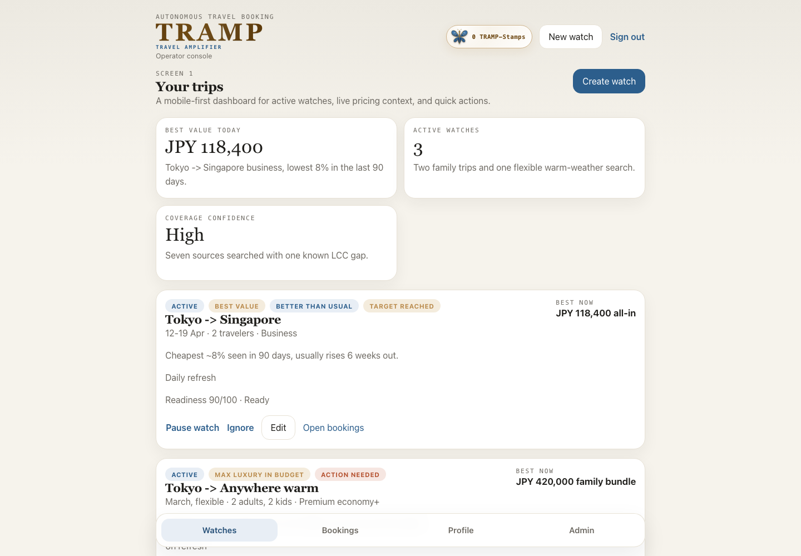
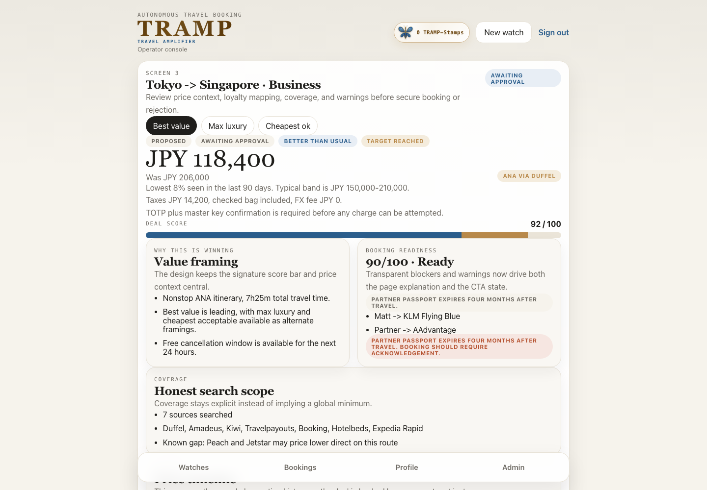
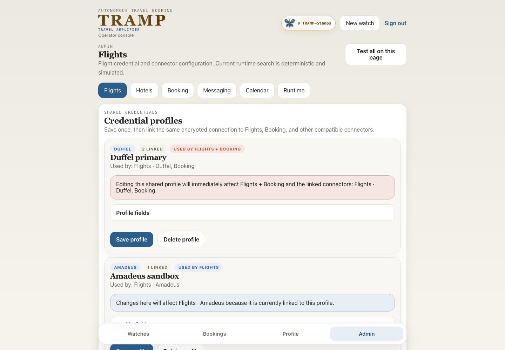
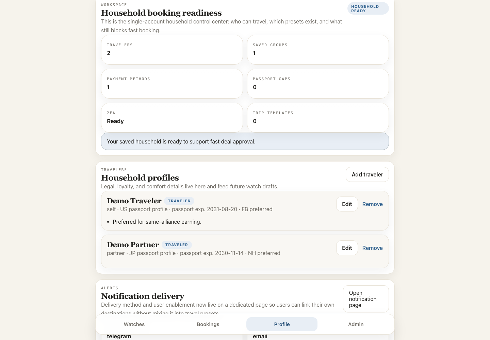

# TRAMP

**TRAMP = Travel Amplifier.**

TRAMP is a localhost-first travel concierge that turns household preferences, price history, coverage, and hard spend limits into a calm path from watch to secure booking. Its Editorial Gold wordmark sits on the established cream, blue, gold, and rust interface: blue marks value, gold marks luxury, and rust marks action that needs attention.

## Product tour

> **Demo-data notice:** Every screenshot below was captured at `1440x1000` with `VITE_API_MODE=mock`. Names, prices, masked payment details, integration states, and balances are demonstration data. No real credentials were loaded and no booking, charge, email, Telegram message, or calendar event was created.



*Watch dashboard — compare active trips, current all-in prices, readiness, value signals, and the next useful action.*



*Deal review — see historical price context, the value score, loyalty mapping, coverage gaps, and booking readiness before approval.*



*Admin integrations — reuse encrypted provider profiles, understand connector scope, and follow official credential-acquisition guidance.*



*Household workspace — keep travelers, groups, payment readiness, passport gaps, 2FA, and reusable trip setup in one place.*

## Core capabilities

- Monitor trip watches and rank offers for maximum luxury per dollar rather than headline price alone.
- Explain all-in pricing, recent price history, timing, source coverage, and known inventory gaps.
- Reuse household travelers, loyalty programs, traveler groups, preferences, payment methods, and trip templates.
- Execute the in-app booking action through the guarded `/bookings/approve` flow with a signed approval token, saved payment method, TOTP, optional master-key unlock, spend guardrails, and idempotency.
- Award one TRAMP-Stamp for each successful live booking, backed by an immutable per-booking ledger.
- Manage encrypted provider settings and structured setup guidance from the Admin workspace.
- Preview and selectively purge simulated activity without deleting household setup, watch definitions, live bookings, or earned stamps.
- Track booking attempts, notification and calendar diagnostics, cancellations, refunds, and local disruption tests.

## Quick start

1. Create a private local environment:

   ```bash
   cp .env.example .env
   ```

2. Set at least `APP_SECRET`, `INITIAL_ADMIN_EMAIL`, `INITIAL_ADMIN_PASSWORD`, `POSTGRES_PASSWORD`, and, when needed, `PUBLIC_BASE_URL`.

3. Start the stack:

   ```bash
   docker compose up --build
   ```

4. Open `http://localhost`, sign in with the private `INITIAL_ADMIN_EMAIL` and `INITIAL_ADMIN_PASSWORD` values, and complete TOTP enrollment.

The stack includes the React/Vite frontend, FastAPI API, Celery worker and scheduler, PostgreSQL 16, Redis, Caddy, and optional Vault support. Provider credentials belong in the Admin UI or private environment, never in source control.

For a frontend-only demonstration with no backend credentials:

```bash
cd frontend
npm ci
VITE_API_MODE=mock npm run dev
```

Mock mode uses deterministic local data and does not call the booking, notification, calendar, or provider APIs.

## Provider access and credential acquisition

After signing in as an administrator:

1. Open `Admin`, then choose Flights, Hotels, Booking, Messaging, or Calendar.
2. Expand `How to get ... credentials` beside the relevant form.
3. Follow the official provider link and begin with test access where available.
4. Save credentials in a reusable profile or directly on one connector.
5. Link reusable profiles where supported, then run `Test connection`.
6. Read the connector's runtime note before enabling anything that can contact an external system.

Official acquisition guidance:

- **Flights:** register in the [Amadeus developer portal](https://developers.amadeus.com/) and use its [application quick start](https://developers.amadeus.com/self-service/apis-docs/guides/developer-guides/quick-start/), or start from [Duffel signup](https://duffel.com/) and its [dashboard token setup](https://duffel.com/guides/getting-started). New Kiwi Tequila partnerships are invitation-only according to [Kiwi's official announcement](https://media.kiwi.com/articles-and-interviews/better-for-business-kiwi-com-takes-a-new-approach-to-partnerships/).
- **Hotels:** [register for a Hotelbeds API key](https://developer.hotelbeds.com/register/) and follow its [getting-started guide](https://developer.hotelbeds.com/documentation/getting-started/); Hotelbeds requires both the key and Secret for X-Signature authentication. Booking.com starts with its [affiliate application](https://partnerships.booking.com/), but affiliate signup does not guarantee API access: Demand API requires confirmed **Managed Affiliate Partner** status, Partner Centre access, and the documented [Demand API prerequisites](https://developers.booking.com/demand/docs/getting-started/prerequisites).
- **Booking:** direct Duffel setup uses `access_token`, Amadeus uses `client_id` and `client_secret`, and Kiwi uses `api_key` after invitation-only access. A compatible shared provider profile can supply the same credential shape.
- **Notifications:** `log_only` and a local Mailpit sink need no universal API key. Hosted SMTP can send external email. Create a bot with [BotFather](https://t.me/BotFather), then follow the official [BotFather tutorial](https://core.telegram.org/bots/tutorial); Telegram mode can send external messages.
- **Calendar:** [enable the Calendar API](https://console.cloud.google.com/flows/enableapi?apiid=calendar-json.googleapis.com), create [Google Cloud OAuth credentials](https://console.cloud.google.com/apis/credentials), and follow Google's [create events guide](https://developers.google.com/workspace/calendar/api/guides/create-events). Authorize `https://www.googleapis.com/auth/calendar`; Google mode can create and delete live events.

Saving credentials records configuration; it does not turn a simulated flight, hotel, or booking adapter into a live provider implementation. The guarded booking UI uses the real booking endpoint, but a TRAMP-Stamp is awarded only when the configured executor returns a successful, non-simulated live booking. Hosted SMTP, Telegram, and Google Calendar are different: those modes can create external side effects when configured and invoked.

## TRAMP-Stamps

Each successfully created live booking earns exactly one TRAMP-Stamp. The booking transaction writes a ledger row keyed uniquely to the booking, so retries and idempotent replays cannot duplicate the reward.

No stamp is awarded for mock inventory, simulated providers or payloads, failed attempts, approval intent without a booking, or a replay of an already-booked request. Cancellation does not remove an earned stamp in this release.

When the booking response reports `tramp_stamps_awarded: 1`, an ornate blue-and-gold butterfly descends, flutters, settles, and reveals `+1 TRAMP-Stamp`. Reduced-motion users receive the final static reward state. The persistent badge reads the balance calculated from the ledger.

## Mock behavior and selective purge

`VITE_API_MODE=mock` is the deterministic, credential-free frontend mode used for the screenshots. Mock booking remains simulated and never earns a stamp.

The live stack also has an Admin → Runtime policy for fallback mock inventory. Disabling fallback mock data leaves empty states when no real connector supplies inventory; it does not fabricate live results.

To remove generated test activity without resetting the household:

1. Open `Admin` → `Runtime`.
2. Select `Preview purge` and review the per-table counts.
3. Copy or type the exact confirmation phrase `PURGE TEST DATA`.
4. Confirm the preview-bound purge.

The selective purge removes simulated observations, deals, attempts, bookings, related diagnostics, and derived price statistics. It preserves users, travelers, groups, preferences, payment methods, trip templates, watch definitions, integration configuration, live activity, and the TRAMP-Stamp ledger.

## Safe operations

- Notification and calendar modes default to `log_only`.
- Simulated search, booking, cancellation, and local disruption activity is forced to log-only delivery even when an external transport is configured.
- Most connection tests validate local credential presence and shape; the UI identifies checks that make provider network requests.
- Hosted SMTP, Telegram, Google Calendar, and a genuinely live booking provider must be treated as external side effects.
- Health is available at `GET /api/v1/health`.
- Restart, migration, booking, purge, screenshot-refresh, and verification procedures are in the [TRAMP runbook](docs/runbook.md).

Additional references:

- [Build specification](travel-autobook-spec.md)
- [Restart-safe operations runbook](docs/runbook.md)
- [Local environment template](.env.example)
